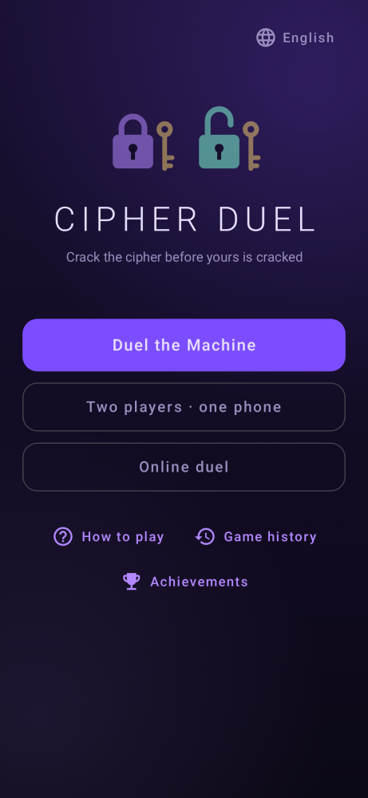
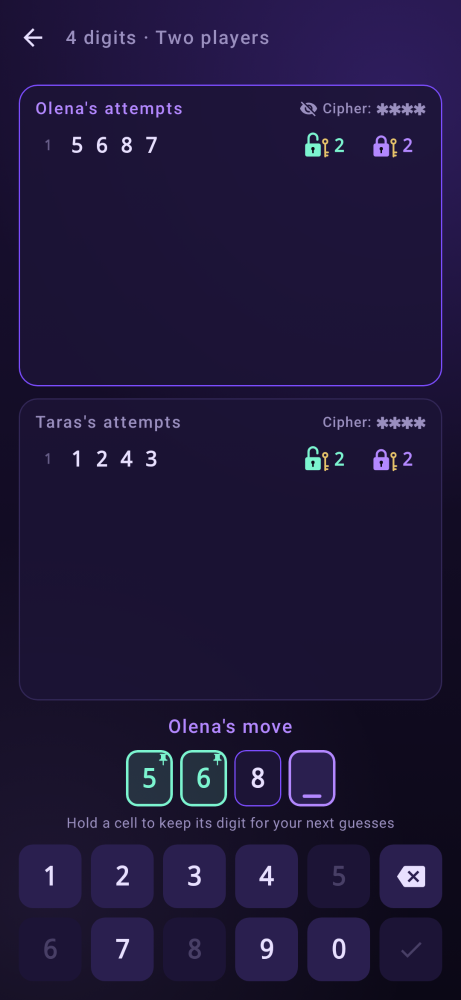
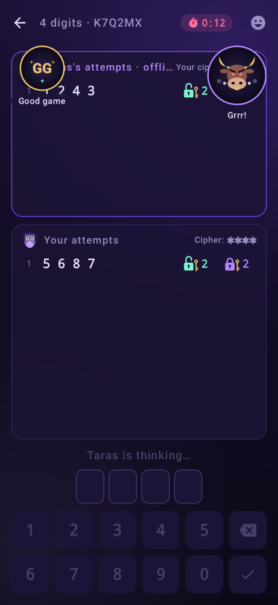
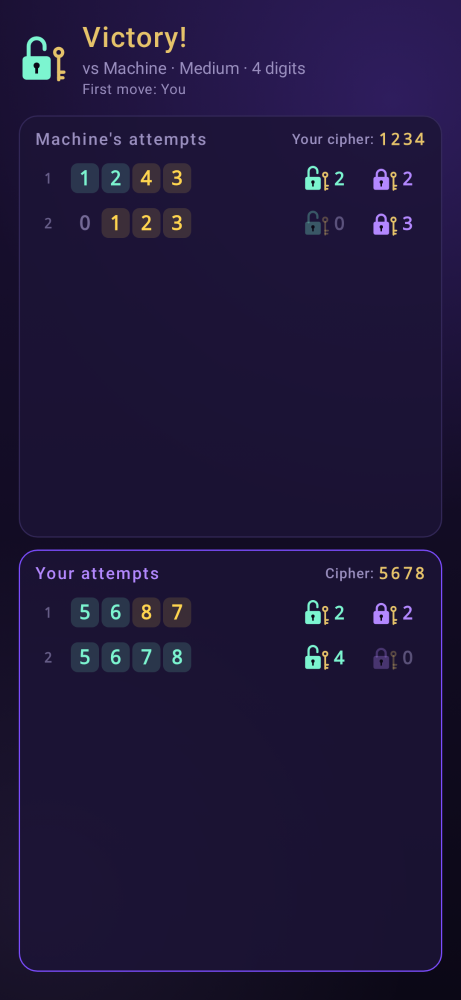
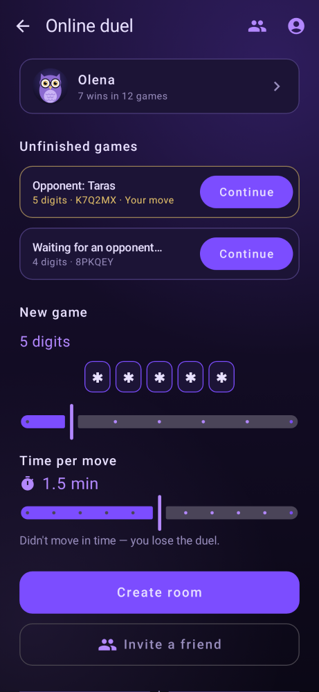
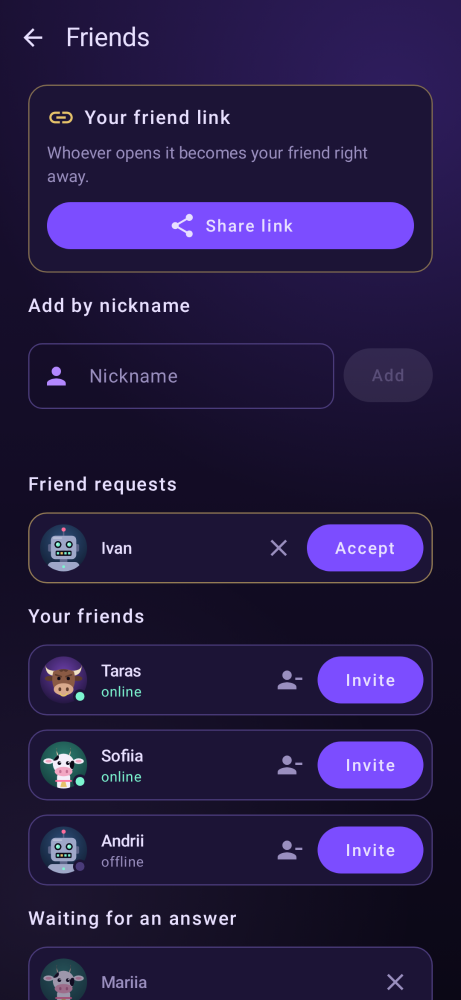
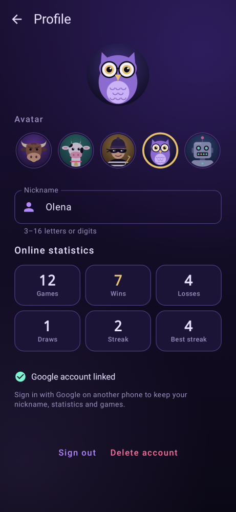
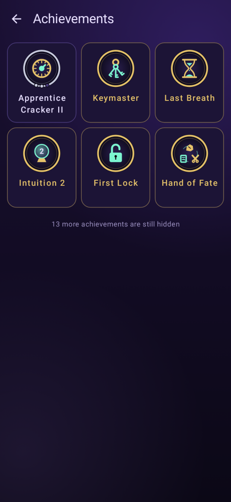
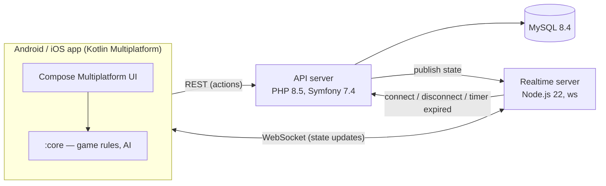

# Cipher Duel

**A cross-platform multiplayer game built end-to-end through AI-assisted development.**
I took it from a one-paragraph idea to a live production system in **about 12 hours of hands-on sessions**
by directing [Claude Code](https://claude.com/claude-code), an AI coding agent: I owned the product, the decisions and
the verification process, and the agent wrote the code.

<p>
  
  
  
  
</p>
<p>
  
  
  
  
</p>

## At a glance

| | |
|---|---|
| **Time spent** | ~10–14 hours of active sessions with the agent on 8 days between 7 Oct and 2 Nov 2026, about 70 prompts from me; [how this was measured](docs/ai-workflow.md#6-time-spent) |
| **Scope** | Android + iOS app (Kotlin Multiplatform), REST API (PHP / Symfony), WebSocket server (Node.js), MySQL, VPS |
| **Size** | ~17,000 lines of Kotlin, PHP and JavaScript |
| **Tests** | ~200 automated tests: unit, UI screenshot, cross-language rule vectors, end-to-end against the live server |
| **Status** | Online server in production; Android release builds in use; iOS runs in the simulator, awaiting Apple Developer approval |

## How I worked with the AI agent

The full write-up with real examples is in [docs/ai-workflow.md](docs/ai-workflow.md). In short:

1. **Started from a brief, not from code.** The project began as a short description of the game in
   `requirements.txt` (quoted in the [write-up](docs/ai-workflow.md#1-from-a-brief-to-a-plan)). The agent had to propose a stack and plan first; nothing was built until
   I agreed to it. Every larger stage after that followed the same rule.
2. **Context engineering.** The agent's working knowledge lives in versioned files: a root
   [`CLAUDE.md`](context/CLAUDE.md) with project rules and one per component ([mobile](context/mobile-CLAUDE.md),
   [server](context/server-CLAUDE.md), [realtime](context/realtime-CLAUDE.md)) describing architecture, conventions and pitfalls.
   The agent keeps them up to date as part of every change, so each new session starts with accurate context.
   A separate persistent memory tracks what is deployed versus only committed.
3. **Guardrails.** Production secrets never enter the repository or the chat; the SSH key is off-limits to the agent;
   personal data is not sent to third-party services; nothing is deployed, committed or pushed without my explicit OK.
4. **Verification as the contract.** A change is not done until one command passes: unit tests, screenshot tests,
   a release build and an iOS compile check, plus the server and realtime test suites. Game rules are shared as
   [test vectors](docs/ai-workflow.md#4-verification) that both the Kotlin and the PHP implementation must pass, so the
   two can't drift apart.
5. **Working around the environment.** The dev machine is Linux with no Android emulator and no Mac. So the agent
   "sees" the UI through screenshot tests (it renders every screen to PNG and reviews the images), and iOS is built
   and launched in a cloud simulator (Codemagic).
6. **The agent proposes, I decide.** For non-trivial features the agent first lays out the design, edge cases and
   alternatives; I make the product calls. Example: the AI opponent's difficulty model, which I chose over the agent's
   first proposal, and the digit-pinning feature walked through step by step in the write-up.
7. **Real-device testing.** I play every build on a phone and feed back bugs and UX issues; bugs that the automated
   tests missed get a regression test.

## The game

Each player picks a secret code of unique digits (4–10 long, `0` allowed); players take turns guessing the opponent's
code. After every guess an **open lock** counts digits in the right place and a **closed lock** counts right digits in
the wrong place. Rock–paper–scissors decides who goes first; if the first player cracks the code, the second one gets a
last guess, so a draw is possible.

- Against the computer (easy / medium / hard), two players on one phone, or online on two phones.
- Online: rooms by code or invite link, optional turn timer, automatic reconnect, emotes.
- Guest accounts or Google Sign-In; stats, history and achievements synced across devices.
- Friends with online status, friend links and game invitations.
- Tap a cell to choose which position to type; long-press to pin a digit you are sure of for the next guesses.
- English and Ukrainian UI.

## Architecture



- **The server is the single source of truth** for online games. The app sends actions over REST; the API validates
  them in a transaction (row lock on the room), increments the room version and publishes the new state.
- **The realtime server has no game logic.** It delivers each player their own view of the room, tracks presence and
  reports expired turn timers back to the API. The app drops states older than the one it already has.
- **Each player only receives their own view:** the opponent's code is sent only after the game ends.
- **Computer opponent:** the hard level always plays a guess consistent with every hint so far; easy and medium
  remember only the last few hints, and that memory grows during the game, which plays more like a human.

## Tech stack

| Part | Technologies |
|---|---|
| Mobile | Kotlin Multiplatform, Compose Multiplatform, Navigation Compose, Ktor, kotlinx.serialization, DataStore, Credential Manager / GoogleSignIn |
| API server | PHP 8.5, Symfony 7.4, Doctrine ORM, MySQL 8.4, Symfony Security, rate limiting |
| Realtime | Node.js 22, `ws` |
| Infrastructure | Hetzner VPS (Ubuntu), nginx, systemd, Let's Encrypt; Codemagic for iOS builds |
| Testing | JUnit, Robolectric, Paparazzi screenshot tests, PHPUnit, `node:test`, end-to-end tests against the live server |
| AI tooling | Claude Code (agent), `CLAUDE.md` context files, persistent memory, test-gated workflow |

## Source repository layout (private)

```
mobile/    Android & iOS app (Kotlin Multiplatform)
  core/      platform-independent rules, AI opponent, achievements
  shared/    UI, view models, networking, storage
  app/       Android shell + all app tests
  iosApp/    iOS shell (SwiftUI host)
server/    REST API (Symfony); protocol in server/API.md
realtime/  WebSocket server (Node.js)
shared/    rule test vectors used by both Kotlin and PHP tests
```

## What's in this repository

The source code is in a private repository. This one shows how the project was built:

- [`docs/ai-workflow.md`](docs/ai-workflow.md) — the full write-up with examples and how the time was measured.
- [`context/`](context) — the agent's context files and the working plan, translated to English. The originals are in
  Ukrainian, my working language with the agent. Server addresses, access details and secret locations are redacted.
- [`images/`](images) — screenshots, rendered by the project's screenshot tests.

I'm happy to walk through the code, the git history and the agent sessions in a call, and to share an Android build.

**See also:** [Eldvir](https://github.com/WarGeneration/eldvir-showcase), a text RPG where an LLM narrates and a
deterministic engine rules: how the game uses the model, how models were chosen by evaluation runs, and how a second
model (Codex) reviews the agent's work.

## License

All rights reserved, see [LICENSE](LICENSE). The materials here are published for viewing only.
